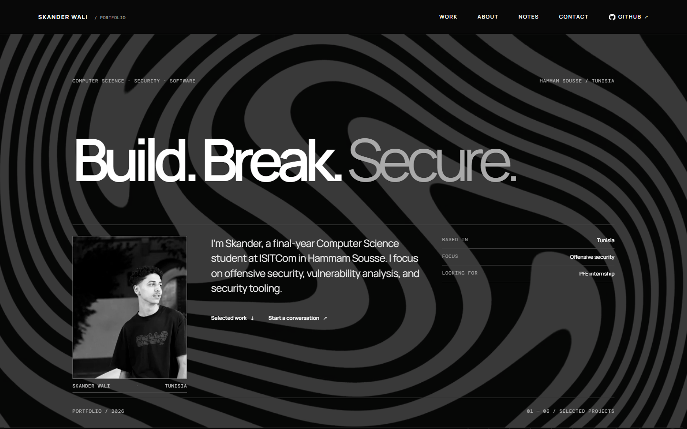
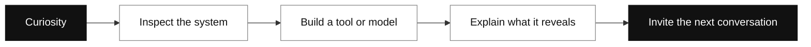
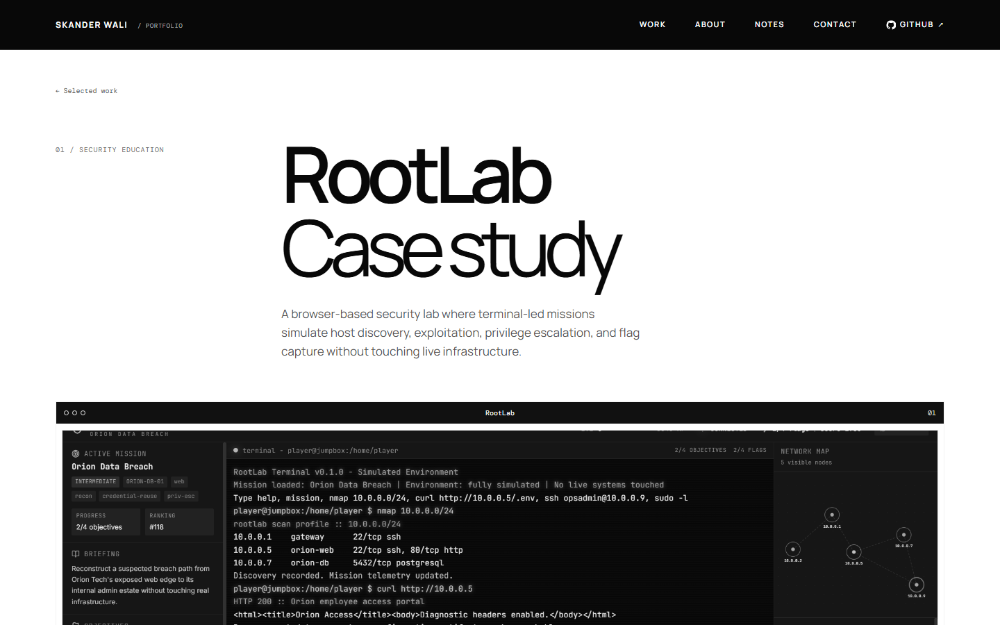
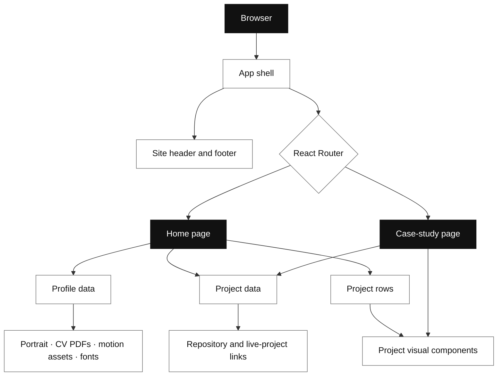
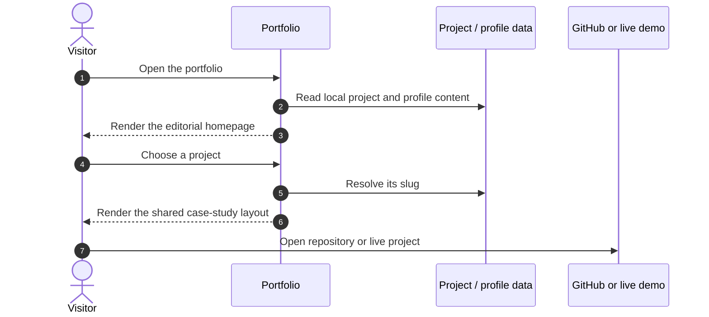

<div align="center">

# SKANDER WALI

### Security-minded systems. Software built to understand them.

**A personal portfolio about offensive security, digital forensics, and software engineering.**  
Computer Science · ISITCom · Hammam Sousse, Tunisia

<br />


<br />

<a href="#the-idea">The idea</a> · <a href="#selected-work">Selected work</a> · <a href="#architecture">Architecture</a> · <a href="#run-locally">Run locally</a>

</div>

<br />

<p align="center">
  
</p>

<p align="center"><sub>THE FRONT DOOR — large type, a human portrait, and a quiet technical signal.</sub></p>

<p align="center"><a href="docs/media/portfolio-full.png">Open the full-page portfolio capture</a></p>

---

## The idea

Most security interfaces are dense because they need to be. This portfolio gives technical work room to breathe, then lets the details get precise when someone chooses a project.

The visual language borrows from two places: the restraint of an editorial portfolio and the clarity of a security investigation. Black, white, and fine rules keep the surface quiet; terminal references, system maps, and project notes carry the technical character. The beat-making corner stays present as a personal detail, while the work remains IT-first.



### A portfolio with a point of view

| Principle | How it shows up |
| --- | --- |
| **Lead with the person** | A real portrait and a direct statement make the work feel authored. |
| **Show the system** | Project previews are small interface studies, not a wall of generic cards. |
| **Earn the detail** | Case studies explain the project after the visitor chooses to go deeper. |
| **Keep motion in its lane** | Scroll and video effects support the page; reduced-motion and data-saving preferences are respected. |
| **Keep music personal** | Beat production has its own small corner and points to `@prodbyskn`. |

---

## Selected work

Six projects connect security practice, learning tools, and software experiments. The case-study routes use the same content model, so each project can grow without duplicating its page structure.

| Project | Area | In one line |
| --- | --- | --- |
| [RootLab](https://github.com/dustin04x/RootLab) | Security education | Terminal-led offensive-security missions in a safe simulated lab. |
| [ThreatCanvas](https://github.com/dustin04x/ThreatCanvas) | Threat visualization | Simulated attack chains explored through timelines, network graphs, and ATT&CK mapping. |
| [MetaScan](https://github.com/dustin04x/Metascan) | Digital forensics | Client-side image metadata and file-analysis tools for investigation and CTF practice. |
| [Crypto Toolbox](https://github.com/dustin04x/crypto-toolbox) | Cryptography | More than 30 CLI utilities for encoding, ciphers, hashes, and analysis. |
| [AlgoVision](https://github.com/dustin04x/algovision) | Learning | An interactive, real-time view of programming algorithms. |
| [PulseRadio](https://github.com/dustin04x/PulseRadio) | Web audio | A browser tuner for curated SomaFM and RadioBrowser stations. |

<details>
<summary><strong>Open a case study</strong></summary>

Each case study combines a concise overview, a project visual, the stack, and the capabilities that matter. Project facts live in [`src/data/projects.ts`](src/data/projects.ts); `/work/<slug>` is rendered by one shared page in [`src/pages/CaseStudyPage.tsx`](src/pages/CaseStudyPage.tsx).

| Route | What it explores |
| --- | --- |
| `/work/rootlab` | Safe terminal simulation and mission progression |
| `/work/threatcanvas` | Attack-chain visualization and defensive learning |
| `/work/metascan` | Local image forensics and metadata inspection |
| `/work/crypto-toolbox` | CLI utilities and heuristic cipher analysis |
| `/work/algovision` | Interactive algorithm visualization |
| `/work/pulseradio` | Curated internet-radio listening |

</details>

<p align="center">
  
</p>

<p align="center"><sub>PROJECT DETAIL — one consistent frame, with the content changing to fit the system.</sub></p>

---

## Architecture

The site is a client-rendered React application with a small, deliberate component system. Project and profile facts are separated from presentation; each page consumes those facts and composes shared chrome, visuals, and links.



### What happens on a visit



### Repository map

```text
src/
├── App.tsx                   Router, smooth-scroll setup, shared shell
├── pages/
│   ├── HomePage.tsx          Landing page and section composition
│   └── CaseStudyPage.tsx     Data-driven project detail page
├── components/
│   ├── layout/               Navigation, footer, motion backdrop
│   ├── projects/             Project rows, frames, visual treatments
│   └── ui/                   Small reusable icons and arrows
├── data/
│   ├── projects.ts           Project descriptions, stacks, and links
│   └── profile.ts            Contact, education, activities, languages
└── *.css                     Design tokens, page styles, responsive rules

public/
├── cv/                       Downloadable English and French CVs
├── fonts/                    Self-hosted Manrope and DM Mono
├── motion/                   Optimized background video and poster
└── projects/                 Project preview imagery

docs/media/                   README screenshots
```

---

## Design system

| Layer | Choice | Purpose |
| --- | --- | --- |
| **Palette** | Paper white, ink black, quiet greys | Strong contrast without a dashboard-like color system. |
| **Display type** | Manrope | Large, compact headlines and clear project titles. |
| **Technical type** | DM Mono | Coordinates, small labels, and system details. |
| **Layout** | Wide editorial grid, narrow reading measure | Gives the work space while keeping descriptions readable. |
| **Image treatment** | Grayscale portrait, framed project previews | Keeps the visual tone consistent across different project interfaces. |

### Interaction model

- Sticky navigation with a compact mobile menu.
- Lenis smooth scrolling connected to GSAP ScrollTrigger.
- A single entrance sequence and restrained section reveals.
- Background video begins only after the page is loaded and idle; it pauses when hidden or out of view.
- Reduced-motion and `Save-Data` preferences disable the background video.
- Visible keyboard focus and semantic labels support keyboard and assistive-technology use.

---

## Run locally

### Requirements

- Node.js 20 or newer
- npm

### Start the development server

```bash
git clone <repository-url>
cd skander-wali-portfolio
npm install
npm run dev
```

Vite prints the local URL after the server starts.

### Production build

```bash
npm run build
npm run preview
```

### Available scripts

| Command | What it does |
| --- | --- |
| `npm run dev` | Start Vite with hot reload. |
| `npm run lint` | Check the application source with Biome. |
| `npm run build` | Type-check and create the production bundle. |
| `npm test` | Run the Playwright browser checks. |

---

## Personal details

The contact section links to email, GitHub, LinkedIn, and the English/French CV downloads. Beat production is linked separately through Instagram: **[@prodbyskn](https://www.instagram.com/prodbyskn/)**.

> The CV PDFs in `public/cv/` contain personal contact details. Review them before publishing this repository publicly.

---

<div align="center">

**Build. Break. Secure.**  
Designed and built by **Skander Wali** · Tunisia · 2026

<sub>Curiosity is the interface. Understanding is the output.</sub>

</div>
